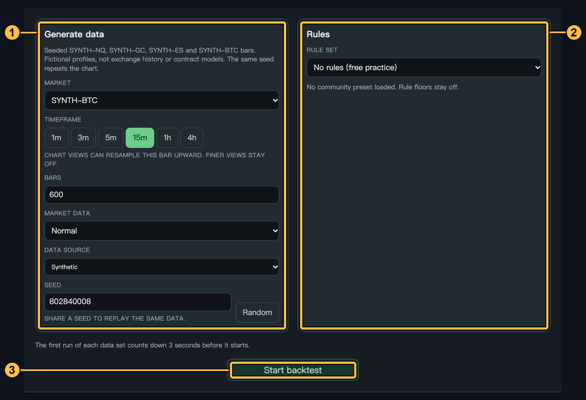
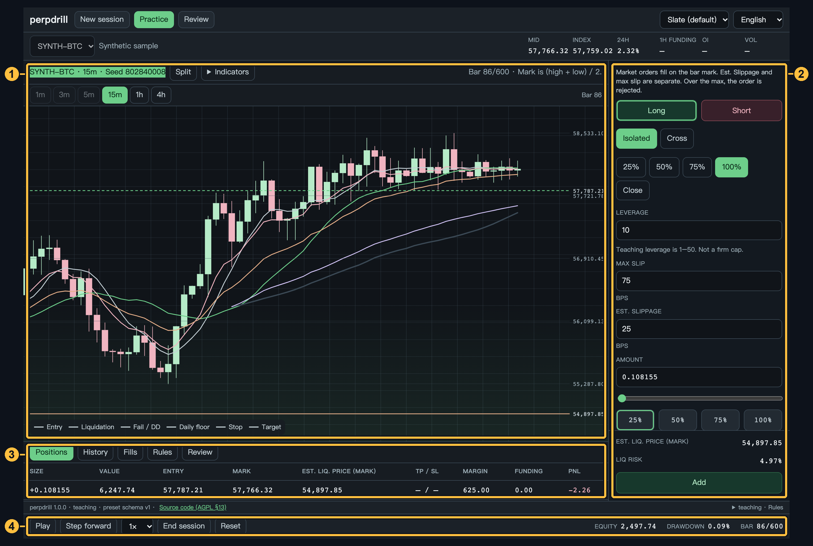
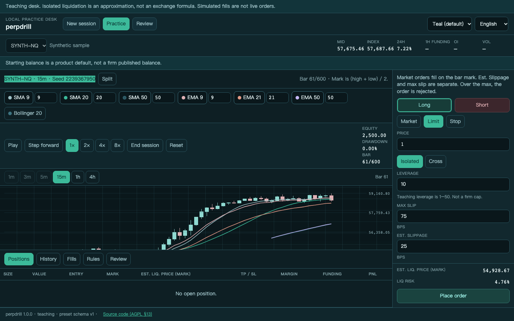
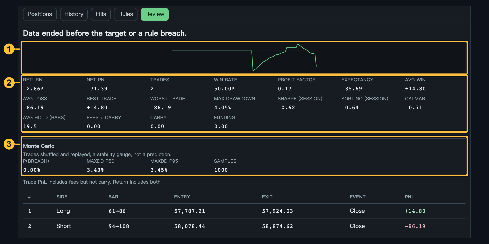
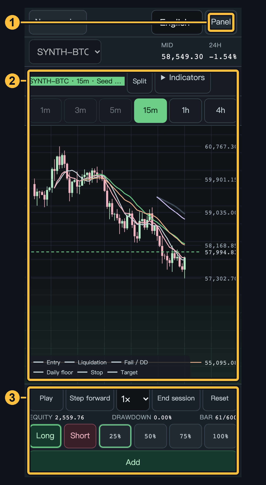

# perpsdrill

本機優先的教育用模擬／回放練習台骨架，用來對照加密永續合約、類 prop 規則做練習。這不是交易所客戶端，也不會下真單。

**狀態：1.2.0 練習台。** 生成合成數據或載入真實行情（CSV／Binance 公開資料），設定規則（自訂／社群預設／無），逐根播放、下市價／限價／觸價單、加減倉、資金費結算、mark price 強平，圖表有十字游標、O/H/L/C 讀數同可拖拉縮放嘅價格軸，檢討有完整指標與蒙特卡羅穩健性參考。強平仍是隔離教學近似，不是交易所公式，也不是官方評測結果。

儲存庫：<https://github.com/Kinfxhk/perpdrill>

線上版面（GitHub Pages，與本機同一版本；手機、平板、桌面三種版面）：<https://kinfxhk.github.io/perpdrill/>。由 `main` 的 Pages workflow 部署。

## 快速上手（圖解）

<sub>所有截圖使用生成的合成示範資料，並非真實市價。</sub>

生成數據提供 **SYNTH-NQ、SYNTH-GC、SYNTH-ES、SYNTH-BTC，共四組**，可於自由練習或自訂規則選用。這些是本機種子生成的虛構樣本，不是 CME／交易所歷史行情，也不是相應期貨合約模型；原有 NQ／GC 名稱保留舊版參數以維持重現性，BTC 使用獨立設定。預設方案仍只顯示其原本允許的市場。第三方真實行情有獨立條款，不因程式採 AGPL 就可任意再分發。

1. **設定 → 開始回測**：揀市場、時框、K 線數量同規則（自訂／社群預設／無規則）。資料源可揀合成、CSV 檔案或 Binance 實時行情。每組資料第一次開始前有 3-2-1 倒數，可以 **Skip**（立即開始）或 **Cancel**（返回設定）。撳 **Start backtest**。

   圖中黃框：**① 生成資料設定　② 規則　③ 開始回測**。

   

2. **練習台**：圖表佔據主要版面（滾輪縮放、拖曳平移、Split 分割雙圖、切時框），右邊落單票（市價／限價／觸價、槓桿、滑點上限、TP/SL），下方持倉／成交／規則／檢討分頁。**Indicators** 喺圖表工具列開出浮動面板，唔會逼細個圖；底部係回放列（Play／Step／速度／End session／Reset）加權益／回撤／根數。

   圖中黃框：**① 圖表及指標工具　② 落單票　③ 持倉／檢討分頁　④ 回放控制**。

   

3. **落單**：揀方向（Long/Short）、數量（交易力 25–100%）、單型。限價／觸價單會掛喺 **Working orders**，隨時可取消。持倉之後：同向落單＝**加倉**（平均成本），反向＝**反手**，收市用 **25/50/75/100%** 分檔平倉。圖表會畫出進場線、強平線（估價）同 Fail／每日地板線。

   落單近鏡黃框：**① 方向　② 分檔平倉＋Close　③ 落單比例　④ 送出／加倉**。

   

4. **檢討**：權益曲線、勝率、盈虧比、Sharpe／Sortino／Calmar、手續費／持倉成本／資金費分列，同蒙特卡羅穩健性參考。撳 **End session** 提早收場會直接開檢討分頁。

   圖中黃框：**① 權益曲線　② 績效指標　③ 蒙特卡羅穩健性參考**。

   

5. **手機都玩到**：窄屏圖表依然係主角，落單票同持倉收喺側邊抽屜（**Panel** 掣），底部係回放＋落單列。

   圖中黃框：**① Panel 抽屜入口　② 圖表　③ 回放＋落單列**。

   

## 這是什麼

perpdrill 想成為一個開源、在瀏覽器裡就能用的永續合約練習台：歷史 K 線逐根前進、用保證金／槓桿／資金費或廠商 swap／強平來記帳，並套上可匯出的規則集。概念上承接 [CandleDrill](https://github.com/Kinfxhk/candledrill)（AGPL-3.0-or-later）的回放、OHLC 成交與規則評估想法。介面、色盤與期貨合約模型不沿用 CandleDrill。歸屬寫在 `NOTICE`。

練習台可以逐步播放合成 K 線（1 分、3 分、5 分、15 分、1 小時、4 小時）、用 Trading Power 的 25%／50%／75%／100% 下市價單、看持倉與損益、預估強平價（標記）與 Liq Risk，並在圖上畫進場線與強平線。圖表可以把同一組 K 線往上合併，或上下分割成兩張；比樣本更細的週期不會假造。滑點上限預設 75 bps（可調 50–100），模擬衝擊預設 25 bps，超過上限就拒絕。維持保證金是初始保證金的一半。Fail／回撤線不跟強平線共用。

## 本地檢查

需要 Node.js 22 或更新（見 `.nvmrc`）。

```bash
npm ci
npm run check
```

`npm run check` 依序執行：

- `lint`
- `format:check`
- `typecheck`
- `test`
- `check:licenses`
- `check:hygiene`
- `check:secrets`

開啟線框（<http://127.0.0.1:43127>）：

```bash
npm run dev
```

伺服器只印版本，不會聽埠：

```bash
npm start
```

要在本機看那一行字，再執行 `npm run listen`（預設 `127.0.0.1:47221`）。

## 教育聲明與非附屬

- 教育與練習工具，不是投資建議。
- 模擬成績不等於真實成交，也不等於任何 prop 評測的官方結果。
- 成交是教學近似。OHLC／標記模型有先天限制。
- 不保證任何人通過任何評測。
- 永續與槓桿可以虧光保證金。介面上的強平價是估計，不是交易所的封閉公式。
- perpsdrill 與任何交易場所、prop 廠商沒有附屬、背書或客戶關係。請勿把本專案當成他們的官方軟體。
- 專案方向是不加廣告、不收集遙測、不以付費牆當作使用條件。

## 真實資料（選用）

練習資料預設係合成 K 線。設定頁可以改來源：

- **CSV 檔案**：匯入 `time,open,high,low,close[,volume]` 格式（time 為 Unix 毫秒或 ISO 日期），嚴格驗證後逐根練習。
- **實時（Binance）**：瀏覽器直接從 Binance 公開資料端點（data-api.binance.vision）下載 klines，無需 API key、不經伺服器、不綑綁任何資料檔；畫面標示「Market data by Binance」。資料只存於你的瀏覽器，練習結束不會上傳。

真實行情同合成資料一樣，強平仍是教學近似，唔係交易所公式。

## 預設來源

`presets/` 有 13 份教學方案 JSON（Instant、Evaluation、2-Step）。下拉選單與規則標題只用教學名，不寫廠商名稱。最大回撤是靜態金額（`maxDrawdownUsd`）：地板＝起始資金減去該金額。來源網址留在 JSON，畫面上不以網址當文字。模擬結果不是官方評測。產品程式碼（`packages/`）不寫廠商名稱。沒有核到的規則不要補數字。

| 來源                   | 網址                                                            | 說明                                                                                                                          |
| ---------------------- | --------------------------------------------------------------- | ----------------------------------------------------------------------------------------------------------------------------- |
| Vest Capital 方案      | https://next.vestmarkets.com/vest-capital                       | 13 個方案 JSON（`presets/plan-*.json`）：1-Step／2-Step 評測 Silver–Emerald、Instant $500–$50k。2026-10-26 依官網與文件核對。 |
| MyFundedPerps 挑戰筆記 | https://docs.myfundedperpetuals.com/guides/challenges-and-rules | 不再附社群 JSON。費用筆記：https://docs.myfundedperpetuals.com/guides/commissions-and-fees                                    |
| Tradeify Perps         | https://tradeifyperps.co/                                       | 2026-10-26 未能核實公開規則（僅見 waitlist）。不要編造數字。                                                                  |

細節與「強平線 ≠ prop 回撤線」見 [docs/DESIGN-MVP.md](docs/DESIGN-MVP.md)。

## 授權

[GNU AGPL-3.0-or-later](LICENSE)。若你改過程式並讓別人透過網路使用，必須提供對應原始碼（AGPL 第 13 條）。線框頁尾的來源連結指向 <https://github.com/Kinfxhk/perpdrill>。

---

# English

Local-first educational simulator and replay desk for crypto perpetuals and prop-style rules. It is not an exchange client and it does not send live orders.

**Status: 1.2.0 practice desk.** Generate synthetic data or load real quotes (CSV / Binance public data), set rules (custom, community preset, or none), then play bar by bar with market, limit and stop orders, stack and reduce positions, settle funding, liquidate on mark price, read the chart with a crosshair, an O/H/L/C readout, and a draggable price axis, and read the review with full metrics and a Monte Carlo stability gauge. Liquidation is an isolated teaching approximation, not an exchange formula and not an official evaluation result.

Repository: <https://github.com/Kinfxhk/perpdrill>

Online desk (GitHub Pages, the same build; phone, tablet and desktop layouts): <https://kinfxhk.github.io/perpdrill/>. The Pages workflow on `main` deploys it.

## Quick start (pictured)

<sub>All screenshots use generated synthetic sample data, not real prices.</sub>

Generate data offers **four samples: SYNTH-NQ, SYNTH-GC, SYNTH-ES and SYNTH-BTC** for free practice or custom rules. They are local seeded fictional profiles, not CME/exchange history or futures contract models. The legacy NQ/GC ids retain their previous parameters for reproducibility; BTC has a separate profile. Plan presets keep their original allowed markets. Third-party quotes have separate terms: the AGPL source-code license does not grant unrestricted data redistribution.

1. **Set up, then Start backtest**: pick the market, timeframe, bar count and rules (custom / community preset / none). The data source can be synthetic, a CSV file, or live Binance quotes. The first run of each data set counts down 3-2-1; **Skip** starts at once, **Cancel** returns to setup. Press **Start backtest**.

   Yellow boxes: **① generated data settings · ② rules · ③ start**.

   

2. **The desk**: the chart is the dominant surface (wheel zoom, drag pan, Split dual pane, timeframe chips), the order ticket sits on the right (market / limit / stop, leverage, max slip, TP/SL), and the positions / fills / rules / review tabs sit below. **Indicators** opens a floating panel from the chart toolbar instead of squeezing the chart; the bottom is the replay bar (Play / Step / speed / End session / Reset) with equity, drawdown and bar count.

   Yellow boxes: **① chart and indicator tools · ② order ticket · ③ positions/review tabs · ④ replay controls**.

   

3. **Orders**: pick a side (Long/Short), size (25–100% of trading power) and order type. Limit and stop orders sit in **Working orders** until filled or cancelled. While holding: same side adds (averaged entry), opposite side reverses, and the close row flattens 25/50/75/100% at a time. The chart draws the entry, estimated liquidation, and Fail / daily floor lines.

   Order close-up: **① direction · ② fractional close and Close · ③ order-size percentage · ④ submit/add**.

   

4. **Review**: equity curve, win rate, profit factor, Sharpe/Sortino/Calmar, the fees/carry/funding split, and a Monte Carlo stability gauge. **End session** opens the review tab directly.

   Yellow boxes: **① equity curve · ② performance metrics · ③ Monte Carlo stability gauge**.

   

5. **Phone included**: the chart still leads on narrow screens, ticket and blotter fold into a side drawer (**Panel**), and the bottom bar carries replay plus orders.

   Yellow boxes: **① Panel drawer toggle · ② chart · ③ replay and orders**.

   

## What it is

perpdrill aims to be an open-source browser desk: step historical bars, account with margin, leverage, funding or a firm swap, and liquidation, then evaluate an exportable rule set. Replay, OHLC-style fills, and rule evaluation are conceptual lineage from [CandleDrill](https://github.com/Kinfxhk/candledrill) (AGPL-3.0-or-later). The interface, palette, and futures contract model are not taken from CandleDrill. See `NOTICE`.

The desk steps seeded synthetic bars at 1m, 3m, 5m, 15m, 1h, or 4h, sizes market orders at 25% / 50% / 75% / 100% of Trading Power, and shows the position, PnL, Est. Liq. Price (Mark), and Liq Risk. The chart can resample those bars to a coarser timeframe or split into two panes. It does not invent a finer timeframe than the sample. The chart draws Entry and Liquidation; Fail / drawdown stays on its own line. Max slip defaults to 75 bps (adjustable 50–100). Realized impact defaults to 25 bps and a larger impact is rejected. Maintenance is half of initial margin.

## Check locally

Node.js 22 or newer (see `.nvmrc`).

```bash
npm ci
npm run check
```

`npm run check` runs `lint`, `format:check`, `typecheck`, `test`, `check:licenses`, `check:hygiene`, and `check:secrets`.

Desk wireframe at <http://127.0.0.1:43127>:

```bash
npm run dev
```

The server stub prints the version and does not listen:

```bash
npm start
```

`npm run listen` serves that same line on `127.0.0.1:47221`.

## Educational disclaimer and non-affiliation

- Educational practice tool. Not investment advice.
- A simulated result is not a live fill and not an official prop-firm result.
- Fills are a teaching approximation. An OHLC / mark model is still an approximation.
- Nothing here promises a passing evaluation.
- Perps and leverage can consume the whole margin balance. The liquidation price on screen is an estimate, not an exchange's closed form.
- perpsdrill is not affiliated with, endorsed by, or a client of any trading venue or prop firm. Do not treat it as their software.
- The project commits to no ads, no telemetry, and no paywall as a condition of use.

## Real data (optional)

Practice data is synthetic by default. The setup screen can switch the source:

- **CSV file**: import `time,open,high,low,close[,volume]` rows (Unix milliseconds or ISO dates); strictly validated before the bars run.
- **Live (Binance)**: the browser downloads klines straight from Binance's public data endpoint (data-api.binance.vision) — no API key, no server, nothing bundled; the desk shows "Market data by Binance". Data stays in your browser.

Real quotes use the same teaching liquidation approximation, not an exchange formula.

## Preset sources

`presets/` ships 13 teaching-plan JSON files (Instant, Evaluation, and 2-Step). The dropdown and rule heading use teaching names only, with no firm name. Max drawdown is a static dollar amount (`maxDrawdownUsd`): the floor is the starting balance minus that amount. Source URLs stay in the JSON and are not used as on-screen labels. A simulated result is not an official evaluation. Product code under `packages/` does not name firms. Do not invent numbers for a rule that was not verified.

| Source                        | URL                                                             | Note                                                                                                                                                               |
| ----------------------------- | --------------------------------------------------------------- | ------------------------------------------------------------------------------------------------------------------------------------------------------------------ |
| Vest Capital plans            | https://next.vestmarkets.com/vest-capital                       | 13 plan JSON files (`presets/plan-*.json`): 1-Step / 2-Step evaluation Silver–Emerald and Instant $500–$50k. Checked against the plan page and docs on 2026-10-26. |
| MyFundedPerps challenge notes | https://docs.myfundedperpetuals.com/guides/challenges-and-rules | No community JSON is shipped. Fees: https://docs.myfundedperpetuals.com/guides/commissions-and-fees                                                                |
| Tradeify Perps                | https://tradeifyperps.co/                                       | Unverified on 2026-10-26 (waitlist only). Do not invent numbers.                                                                                                   |

See [docs/DESIGN-MVP.md](docs/DESIGN-MVP.md) for liquidation versus prop drawdown lines and the percent-sizing note.

## License

[GNU AGPL-3.0-or-later](LICENSE). If you modify the program and let users interact with it over a network, you must offer the corresponding source (AGPL section 13). The wireframe footer links <https://github.com/Kinfxhk/perpdrill>.

## Packages

| Package             | Role                                                                              |
| ------------------- | --------------------------------------------------------------------------------- |
| `@perpdrill/core`   | Teaching margin, slippage gate, sizing, carry, replay, and the preset parser.     |
| `@perpdrill/web`    | Practice desk. Content-Security-Policy `default-src 'self'`.                      |
| `@perpdrill/server` | Prints `perpdrill 0.1.1 (teaching)`. Optional localhost listener. No trading API. |
